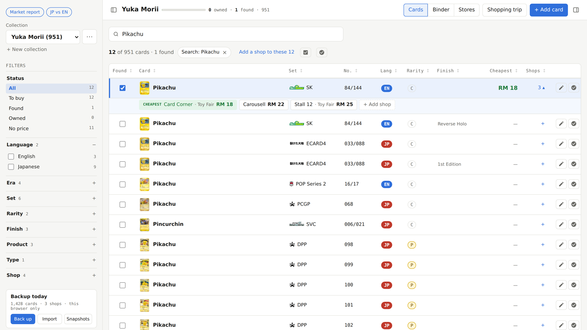
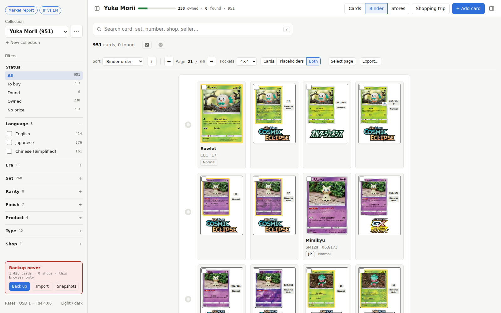

# Card Price Tracker

Find the cheapest shop for every Pokémon card you are hunting. Tick the cards you find, note the shop (or the
seller in a Facebook group or on Carousell) and the price, and the page shows the cheapest one for each card.

**Open it: https://mhafizazizi.github.io/PokemonPriceTracker-Compare/**

- **Free, no account, works offline.** One web page. It runs on a phone too.
- **Your prices stay on your device.** They are saved in your own browser and are never uploaded.
  Press **Back up** to save them to a file, and **Import** to open that file on another device.

## Getting started

1. **Pick a collection** in the list on the left, or make your own with **+ New collection**
   (empty, one whole set, or built from filters such as illustrator or Pokémon).
2. **Record a price.** Found a card at a shop? Tick **Found**, press **+** in the Shops column, choose the venue and
   the shop (or add a new one), type the price and press **Save**. Prices can be in RM, USD or JPY.
3. **Find the cheapest.** The **Cheapest** column shows the lowest price for each card, converted to RM. Click the
   shop count to compare every shop. Bought it? Mark it **Owned**.
4. **Back up.** Your data lives only in this browser, so press **Back up** now and then.

## What's inside

- **Built-in collections:** Wobbuffet, Yuka Morii, Asako Ito and Chaos Rising, with English, Japanese,
  Chinese and Korean prints.
- **Card catalog:** about 87,000 cards from 597 sets (EN, JP, CN, KR) to build your own collections from.
- **Filters and sorts:** language, era, set, rarity, finish, product, type and shop; sort by any column.
- **Binder view:** binder pages from 2×2 to 4×4 pockets, each English card followed by its other-language prints.
  Cards you don't own show their scan in a tile with the card number, finish and set logo. Tick pockets to mark
  several cards owned at once, take cards out of the binder, or **Save layout** so cards keep their pockets.
- **Shopping trip:** enter prices stall by stall, then get a buy list grouped by shop with totals.
- **Export:** print the binder pages or save them as PDF (grey scan, placeholder, colour scan or Both for cards you
  don't own), or a ☐ / ✅ checklist in Excel, one tab per era.
- **Stores view:** every shop, venue and seller you have recorded.

### Extra pages

- **[JP vs EN prices](https://mhafizazizi.github.io/PokemonPriceTracker-Compare/jp-en/yuka-morii/)**: for each
  Japanese print, the Japan sold price (Mercari) against the English card (TCGplayer, eBay asking and sold), in USD or JPY.
  Also for [Wobbuffet](https://mhafizazizi.github.io/PokemonPriceTracker-Compare/jp-en/wobbuffet/).
- **[Market report](https://mhafizazizi.github.io/PokemonPriceTracker-Compare/market/)**: listings recorded from
  local shops and marketplaces.
- **[Sealed products](https://mhafizazizi.github.io/PokemonPriceTracker-Compare/sealed/)**: 2,186 boxes, ETBs, tins,
  blisters, packs and decks from the XY era on, each with a fair price in RM (median of its last 4 sold weeks on TCGplayer).
  Type the price you see in a shop to get Deal / Fair / Overpriced, and compare how each era's products moved.
- Every page has the same switch at the top of the left rail: **Cards | Market | JP vs EN | Sealed**.

Prices on these pages are snapshots from the date shown on each page, not live prices.

## Updates

**24 November 2026**
- **Sealed**: new **MSRP** column (US launch retail price, with how far the fair price is above or below it;
  sortable) for the special sets from Sun & Moon on and the Mega Evolution sets. The fair price now follows a product
  that rose or fell four weeks in a row (newest week) instead of lagging behind it.

**16 November 2026**
- **Sealed products** is now its own page: fair price in RM, a price check box and an era chart. It left the card
  tracker, which loads faster. Every page has the new **Cards | Market | JP vs EN | Sealed** switch.
- Binder: the Both tile is now the only view for cards you don't own (the Cards / Placeholders buttons are gone).
  **Export** still prints grey scans, placeholders, colour scans or Both, with Both as the default.
- Card list: the **Finish** column is now a coloured tag (Holo, Reverse, 1st Edition, Poké Ball, Master Ball) and stays
  visible with the filter panel open on a laptop screen.
- Binder: **Save layout** keeps every card in its page and pocket. A card you remove from the binder leaves an empty
  pocket, and new cards go after the saved ones. **Update** saves the pockets again; **Re-sort** goes back to the
  normal binder order.

**15 November 2026**
- Binder: new **Both** view for cards you don't own. The tile shows the card scan, its number and finish
  beside it, and a large set logo. The same layout can be printed from **Export**.
- Card scans now show for cards in collections you made yourself, and many Japanese scans are sharper.

**14 November 2026**
- Sharper card scans on the published page (Japanese, Chinese and Korean scans were blurry).
- Binder: take cards out of the binder without removing them from the collection.
- Binder: a pocket's price moves to its own line when there is no room beside the badges.

**13 November 2026**
- Binder: **Cards / Placeholders** switch, and placeholder pages in the print export. Chinese and Korean prints
  borrow the set logo of the matching Japanese or English set.
- Market report for every collection, with **Cost to complete** by rarity.

**11 November 2026**
- **No.** sort groups cards by product (main set, special set, promo, deck), then by card number.

**10 November 2026**
- Simplified Chinese sets added to the card catalog.

**9 November 2026**
- New filter panel: filters update each other's counts. Rebuilt card table, Stores view, binder bar and
  **New collection** dialog.

## Data sources

Card lists and scans: [TCGdex](https://tcgdex.dev), [pkmn.gg](https://www.pkmn.gg), the official Japanese card
database (pokemon-card.com), [PokemonTCG data](https://github.com/PokemonTCG/pokemon-tcg-data),
[PTCG-CHS-Datasets](https://github.com/duanxr/PTCG-CHS-Datasets) (Simplified Chinese), and others.
Prices: TCGplayer, Cardmarket, eBay, Mercari and PokeTrace.

## Disclaimer

A personal, non-commercial fan project. Pokémon and all card names and images are © Nintendo, Creatures Inc.,
GAME FREAK inc. and The Pokémon Company. This project is not affiliated with or endorsed by them.
