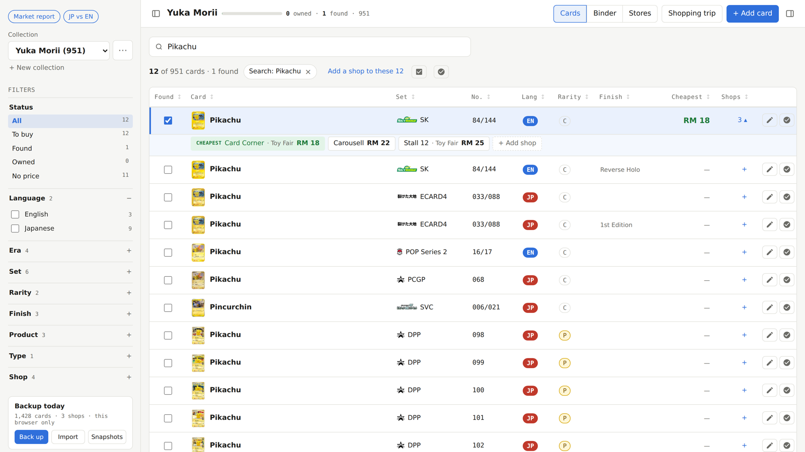

# Card Price Tracker

Find the cheapest shop for every Pokémon card you are hunting. Tick the cards you find, note the shop (or the
seller in a Facebook group or on Carousell) and the price, and the page shows the cheapest one for each card.

**Open it: https://mhafizazizi.github.io/PokemonPriceTracker-Compare/**

- **Free, no account, works offline.** One web page. It runs on a phone too.
- **Your prices stay on your device.** They are saved in your own browser and are never uploaded.
  Press **Back up** to save them to a file, and **Import** to open that file on another device.

## Getting started

1. **Pick a collection** in the list on the left, or make your own with **+ New collection**
   (empty, one whole set, or built from filters such as illustrator or Pokémon).
2. **Record a price.** Found a card at a shop? Tick **Found**, press **+** in the Shops column, choose the venue and
   the shop (or add a new one), type the price and press **Save**. Prices can be in RM, USD or JPY.
3. **Find the cheapest.** The **Cheapest** column shows the lowest price for each card, converted to RM. Click the
   shop count to compare every shop. Bought it? Mark it **Owned**.
4. **Back up.** Your data lives only in this browser, so press **Back up** now and then.

## What's inside

- **Built-in collections:** Wobbuffet, Yuka Morii, Asako Ito and Chaos Rising, with English, Japanese,
  Chinese and Korean prints.
- **Card catalog:** about 86,000 cards from 588 sets (EN, JP, CN, KR) to build your own collections from.
- **Filters and sorts:** language, era, set, rarity, finish, product, type and shop; sort by any column.
- **Binder view:** binder pages from 2×2 to 4×4 pockets, each English card followed by its other-language prints.
- **Shopping trip:** enter prices stall by stall, then get a buy list grouped by shop with totals.
- **Stores view** and **Excel export.**

### Extra pages

- **[JP vs EN prices](https://mhafizazizi.github.io/PokemonPriceTracker-Compare/jp-en/yuka-morii/)**: for each
  Japanese print, the Japan sold price (Mercari) against the English card (TCGplayer, eBay asking and sold), in USD or JPY.
  Also for [Wobbuffet](https://mhafizazizi.github.io/PokemonPriceTracker-Compare/jp-en/wobbuffet/).
- **[Market report](https://mhafizazizi.github.io/PokemonPriceTracker-Compare/market/)**: listings recorded from
  local shops and marketplaces.

Prices on these pages are snapshots from the date shown on each page, not live prices.

## Data sources

Card lists and scans: [TCGdex](https://tcgdex.dev), [pkmn.gg](https://www.pkmn.gg), the official Japanese card
database (pokemon-card.com), [PokemonTCG data](https://github.com/PokemonTCG/pokemon-tcg-data),
[PTCG-CHS-Datasets](https://github.com/duanxr/PTCG-CHS-Datasets) (Simplified Chinese), and others.
Prices: TCGplayer, Cardmarket, eBay, Mercari and PokeTrace.

## Disclaimer

A personal, non-commercial fan project. Pokémon and all card names and images are © Nintendo, Creatures Inc.,
GAME FREAK inc. and The Pokémon Company. This project is not affiliated with or endorsed by them.
